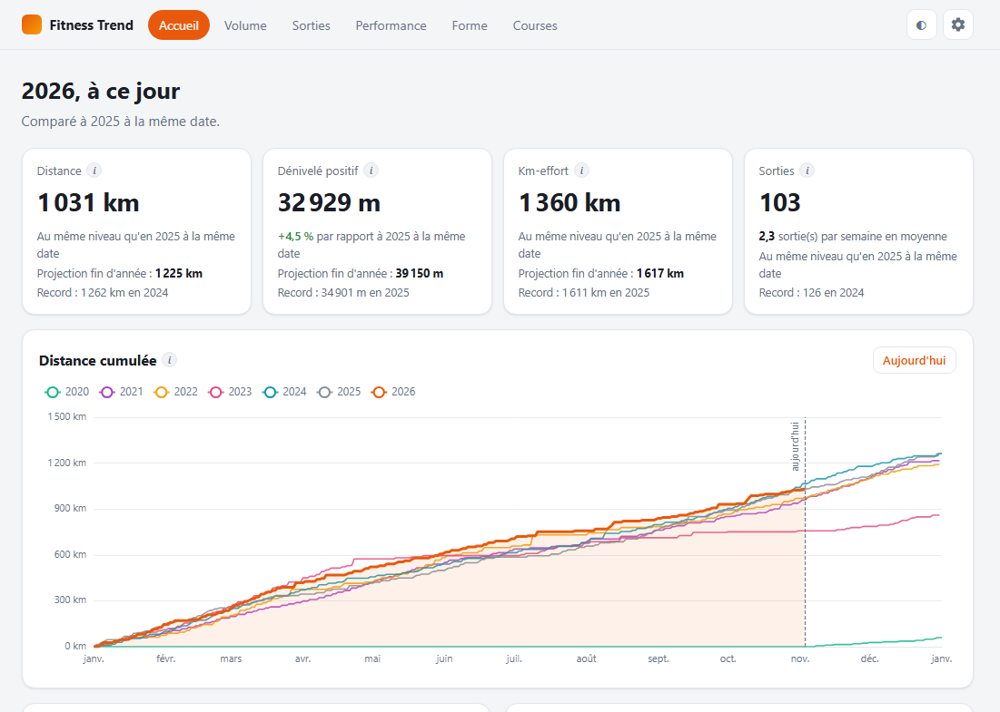
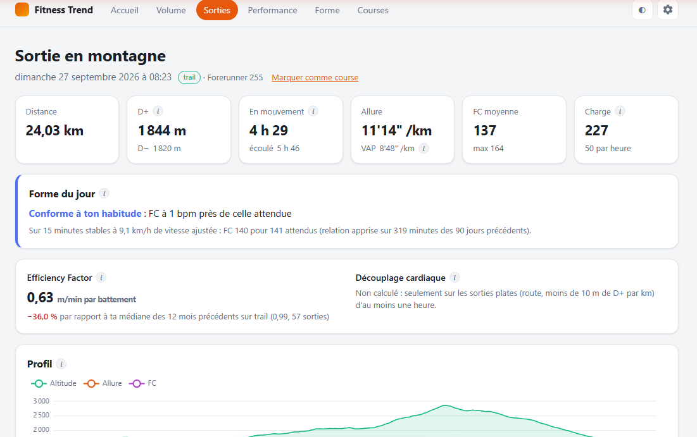
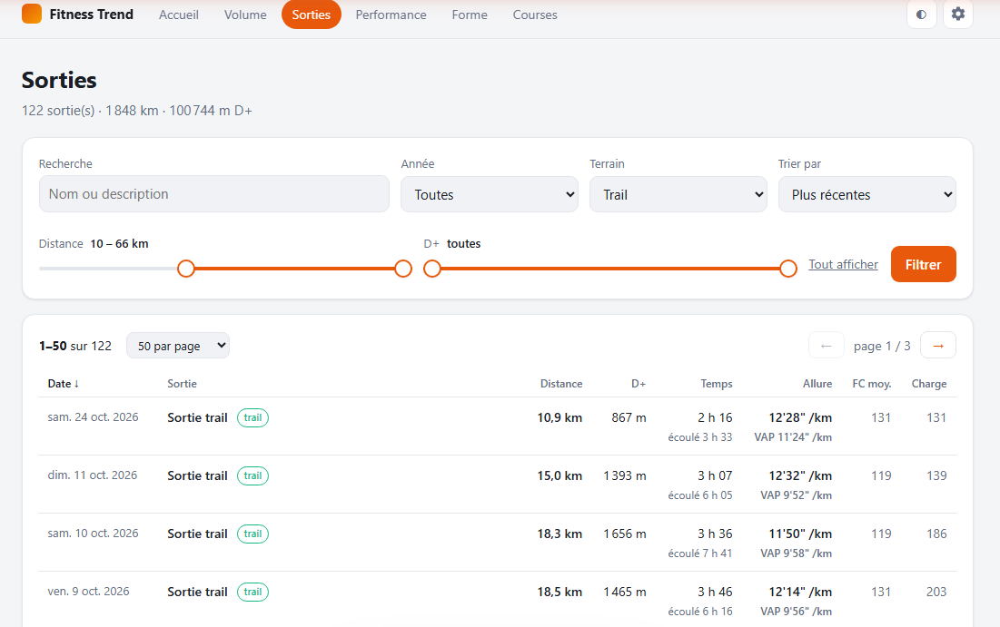
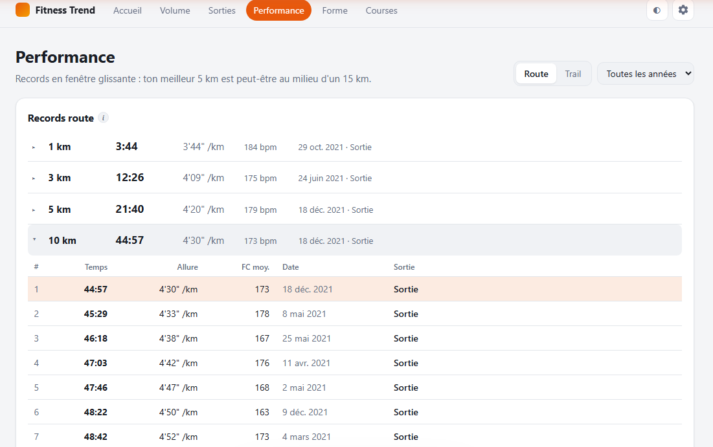
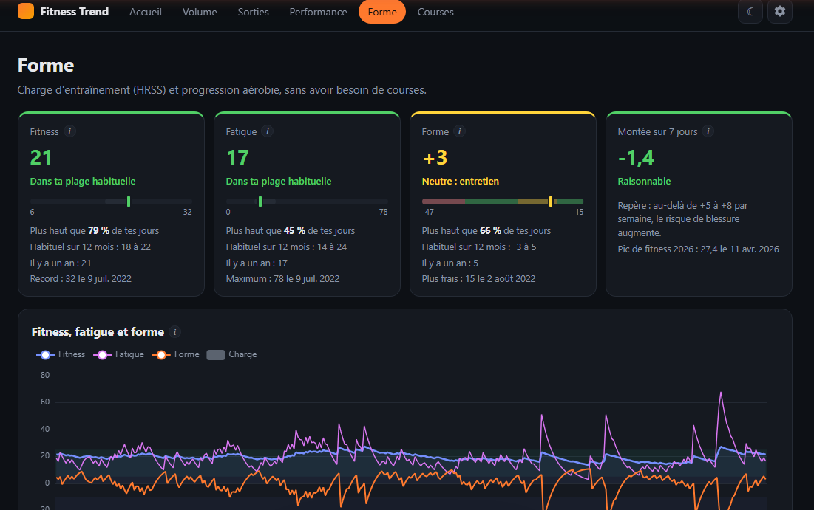

# Garmin Fitness Trend

Statistiques de course à pied auto-hébergées, à partir des activités Garmin Connect : volume,
records, forme, courses, la fiche détaillée de chaque sortie, et un estimateur de temps de
course sur route ou sur le GPX d'un trail.

Une seule image Docker, légère (Python, SQLite, pas de base de données à installer), publiée
pour amd64 et arm64 : elle tourne sur à peu près tout, d'un NAS à un Raspberry Pi ou un vieux
PC. Les données restent chez soi, dans un dossier `data`.

Course à pied uniquement (route, trail, tapis) : les autres sports sont ignorés.



## Fonctionnalités

**Données**

- Synchro Garmin quotidienne : métadonnées et fichiers FIT originaux, téléchargés une seule
  fois. Le FIT est la source de vérité, tout le reste en est recalculé.
- D+ recalculé : altimètre pour les montres à baromètre, sinon modèle numérique de terrain le
  long de la trace (IGN RGE ALTI en France, Copernicus ailleurs).
- Noms et descriptions repris de l'export de compte Strava (pas d'API) ; les sorties faites
  sans montre Garmin sont importées depuis l'archive.
- Métriques versionnées, recalculées automatiquement quand l'algorithme ou les réglages
  changent : temps en mouvement, charge (TRIMP, HRSS), zones de FC sur la LTHR, Efficiency
  Factor, découplage cardiaque, meilleurs efforts en fenêtre glissante, VAM, VAP.

**Pages** (protégées par la connexion de l'admin, ordinateur et mobile, thème clair ou sombre)

- **Accueil** : l'année en cours face à l'an dernier à la même date, projection de fin
  d'année, dernière sortie.
- **Volume et régularité** : cumuls jour par jour de chaque année (distance, D+, km-effort),
  totaux annuels et mensuels, calendrier, semaines actives et séries.
- **Sorties** : liste filtrable (année, terrain, texte, plages de distance et de D+), triable,
  en cartes sur mobile.
- **Fiche de sortie** : carte (Plan IGN, photos aériennes ou OpenStreetMap), profils
  d'altitude, d'allure et de FC, temps et VAP par kilomètre, intervalles (tours de la montre
  ou détection automatique), zones de FC, meilleurs efforts et leur classement, comparaison
  avec les autres passages sur le même parcours, et **forme du jour** : la FC de la sortie
  face à celle attendue à cette vitesse ajustée à la pente. Pour une course, l'estimateur
  rejoué sur sa propre trace (forme de la veille et d'aujourd'hui) face au temps réel, en
  écart cumulé ou en temps de passage le long du parcours.
- **Performance** : records route et trail sur 1 km à marathon (top 10, par année), courbe
  allure-durée, VAM, meilleures montées par palier de D+.
- **Forme** : fitness, fatigue et forme (modèle de Banister) situées dans l'historique, temps
  par zone de FC, Efficiency Factor et découplage cardiaque.
- **Courses** : détection automatique des courses, validation en un clic, forme le jour J.
- **Estimateur** : temps de course « si je courais maintenant », avec une fourchette.
  - Route : formule de Riegel depuis tes meilleurs efforts des 4 derniers mois, chacun ramené
    à ta forme du jour par l'évolution de ta vitesse à FC égale.
  - Trail sur un GPX importé : altitude du MNT, distance équivalente plat selon ton modèle
    allure-pente personnel, fatigue au-delà de 2 h tirée de tes sorties longues, arrêts
    habituels en course ou saisis aux ravitaillements ; tronçons (montée, descente,
    vallonné…), temps de passage et profil.
  - Tes courses passées les plus proches, effet de la forme (plus ou moins de fitness le
    jour J), précision rejouée sur tes courses passées.
  - **Courses suivies** : prédiction enregistrée chaque semaine, courbe avec fourchette et
    objectif, puis résultat une fois la course courue et reliée à sa sortie.

| Fiche de sortie | Sorties |
| --- | --- |
|  |  |
| **Performance** | **Forme** (thème sombre) |
|  |  |

Les noms des sorties sont masqués sur ces captures.

**Admin** : connexion Garmin (MFA compris), synchro manuelle et journal, import Strava,
réglages du D+, LTHR et FC (avec une estimation tirée des sorties), courses probables,
calibration de l'estimateur (correction proposée d'après les courses passées, appliquée sur
demande).

## Installation

Il faut Docker et Docker Compose.

1. **Dossier** : créer un dossier, y copier [`docker-compose.yml`](docker-compose.yml) et
   [`.env.example`](.env.example) renommé en `.env`.

2. **`.env`** : renseigner `HR_MAX`, `HR_REST`, `LTHR`, `SEX`, `TZ`, et `PUID` / `PGID`
   (utilisateur propriétaire du dossier `data`, donné par la commande `id`). Le conteneur ne
   tourne pas en root.

3. **Mot de passe de l'admin** :

   ```bash
   docker compose run --rm garmin-fitness-trend python -m app.auth
   ```

   Copier la ligne `ADMIN_PASSWORD_HASH='…'` affichée dans `.env`, en gardant les guillemets
   simples (le hash contient des `$`).

4. **Démarrer** :

   ```bash
   docker compose up -d
   ```

   L'application écoute sur le port 9193. Pour y accéder depuis l'extérieur, la placer
   derrière un reverse proxy en HTTPS.

5. **Connecter Garmin** : ouvrir `/admin`, se connecter, puis renseigner les identifiants
   Garmin (code MFA saisi dans l'admin si Garmin le demande). Au choix : ne pas mémoriser le
   mot de passe (recommandé, seul le jeton de session est gardé) ou le mémoriser sur le
   serveur. Lancer ensuite le premier import.

   Le premier import télécharge tout l'historique, lit les FIT et calcule l'altitude des
   sorties sans baromètre : de quelques minutes à une demi-heure selon l'historique et la
   machine, une seule fois. Ensuite, la synchro quotidienne ne traite que les nouvelles
   sorties.

## Export Strava

Facultatif, pour les noms et descriptions. Demander l'export de compte sur strava.com
(Paramètres > Mon compte > Télécharger ou supprimer votre compte), puis déposer dans
`data/strava/` (ou envoyer depuis l'admin) :

- l'archive `.zip` complète, au moins une fois : elle contient les traces des sorties faites
  sans montre Garmin, qui sont alors importées ;
- ensuite, le seul fichier `activities.csv` extrait de l'archive suffit.

Seul l'export le plus récent compte ; un fichier déjà traité n'est pas relu.

## Feuille de route

| Phase | Contenu | État |
| --- | --- | --- |
| 1. Socle | Synchro Garmin, lecture des FIT, D+, import Strava, admin, image Docker | Terminée (v0.1) |
| 2. Statistiques | Pages Volume, Sorties, Performance, Forme, Courses ; fiche de sortie ; détection des courses | Terminée (v0.2) |
| 3. Estimateur | Temps de course estimé depuis un GPX ou une distance et la forme actuelle (route : Riegel, références ajustées par la FC ; trail : modèle allure-pente personnel par tronçon, fatigue, arrêts), validé sur les courses passées, courses suivies semaine après semaine | Terminée (v0.3) |
| 4. Coach | Plan d'entraînement adaptatif autour des courses prévues (ou maintien de forme), séances détectées, bilan du dimanche, réajustement ; coach conversationnel qui propose sans imposer | À venir |
| 5. Extensions | Temps par tronçon en trail, envoi des séances vers la montre, idées en attente (météo, carte de toutes les traces, suivi des chaussures…) | À venir |

Le détail et les décisions prises sont dans le cahier des charges,
[`Stats running — idées pertinentes.md`](Stats%20running%20—%20idées%20pertinentes.md) ;
l'historique des versions dans [`CHANGELOG.md`](CHANGELOG.md).

## Développement

```bash
python -m venv .venv
.venv/Scripts/python -m pip install -r requirements-dev.txt   # .venv/bin/python sous Linux
.venv/Scripts/python -m pytest -q
.venv/Scripts/python -m ruff check app tests
DATA_DIR=./data-dev .venv/Scripts/python -m uvicorn app.main:app --port 8765
```

FastAPI, templates Jinja, ECharts et Leaflet embarqués (pas d'étape de build), SQLite et
Parquet. La CI (GitHub Actions) lance le lint et les tests à chaque push ; un tag `vX.Y.Z`
construit l'image pour amd64 et arm64 et la publie sur
`ghcr.io/georgieboyfr/garmin-fitness-trend`.

## Limites connues

- L'API Garmin Connect utilisée (`garminconnect`) n'est pas officielle : elle peut changer.
  Les appels sont espacés, les FIT sont conservés en local et les erreurs sont visibles dans
  l'admin.
- Le service d'altitude IGN demande une connexion Internet au moment du calcul ; en cas de
  coupure, le D+ est simplement reporté à la synchro suivante.
- L'estimateur se cale sur les données de chaque coureur (pentes, fatigue, arrêts, relation
  FC / vitesse), mais ses réglages ont été choisis sur un petit nombre de courses d'un seul
  coureur : l'erreur affichée sur ces courses est flatteuse. La page sépare la vraie
  précision, mesurée sur les prédictions enregistrées avant le départ des courses suivies.
  Avec peu de courses dans l'historique, elle n'est pas mesurable au début.
- Un seul utilisateur.
